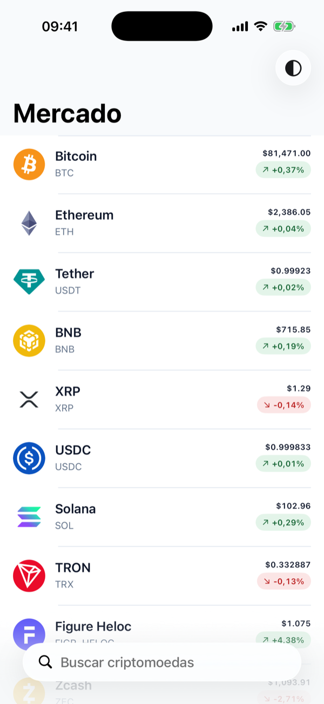
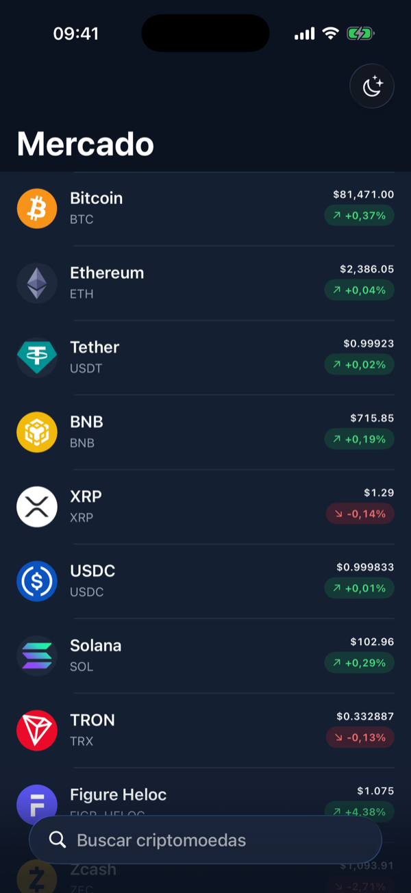
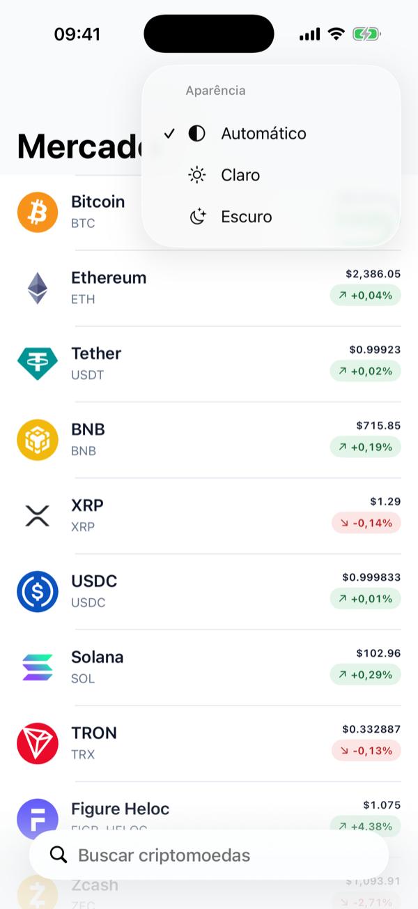
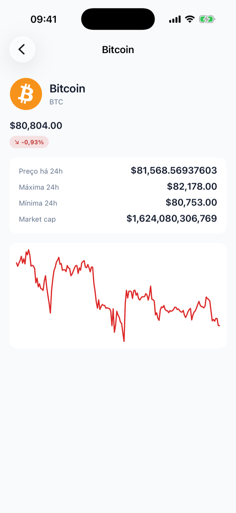
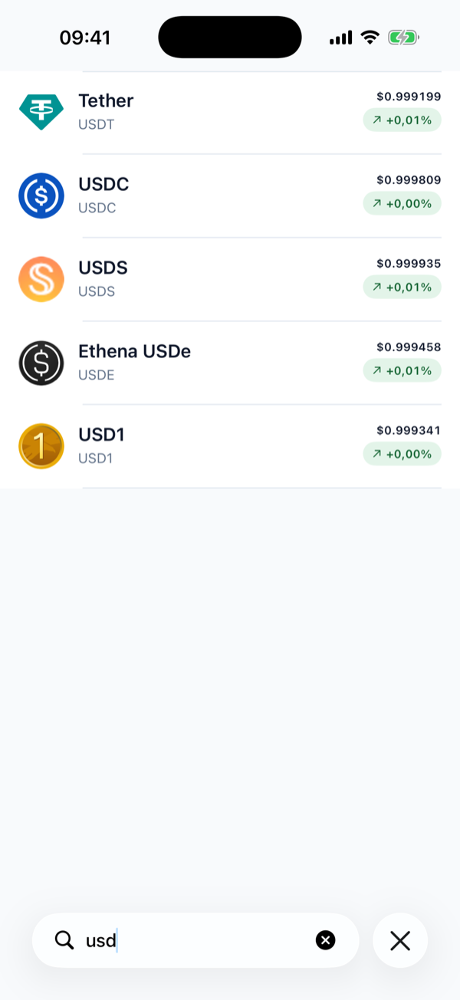
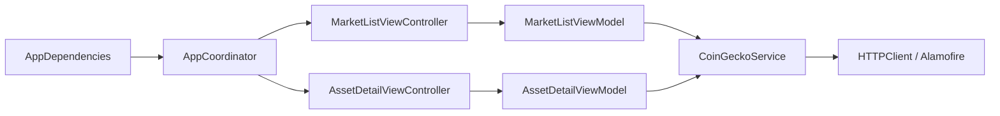

<a id="top"></a>

<h1 align="center">MarketWatch</h1>

<p align="center">
  <strong>Cotações de criptomoedas em um app iOS nativo, reativo e testável.</strong><br />
  UIKit, MVVM-C e RxSwift sobre a API pública da CoinGecko.
</p>

<p align="center">
  <a href="https://github.com/jeancarlosaps/marketwatch-ios/actions/workflows/ci.yml"></a>
  
  <a href="LICENSE"></a>
</p>

<p align="center">
  <a href="#executar"><strong>EXECUTAR →</strong></a>
  &nbsp;·&nbsp;
  <a href="#arquitetura">ARQUITETURA</a>
  &nbsp;·&nbsp;
  <a href="#rxswift">RXSWIFT</a>
  &nbsp;·&nbsp;
  <a href="#testes-e-ci">TESTES</a>
  &nbsp;·&nbsp;
  <a href="#decisoes">DECISÕES</a>
</p>

<p align="center">
  
  
  
  
  
</p>

---

## Visão geral

O MarketWatch é a resposta a um desafio técnico para desenvolvimento iOS: um app de acompanhamento de mercado que lista criptomoedas com cotação atual, abre o detalhe de cada ativo e permite buscar por nome ou símbolo.

O foco está em arquitetura clara, uso idiomático de RxSwift e testes de comportamento. Não há autenticação, carteira nem operações financeiras.

## Funcionalidades

- Lista de criptomoedas por market cap, com nome, símbolo, ícone, preço em USD e variação de 24h em verde ou vermelho.
- Paginação infinita, de 30 em 30 itens, com retry no rodapé quando uma página falha.
- Busca local reativa sobre os ativos já carregados.
- Pull-to-refresh.
- Detalhe do ativo: preço, variação, preço há 24h, máxima e mínima de 24h, market cap e gráfico de 7 dias.
- Estados de loading (skeleton), lista vazia, busca sem resultado e erro com retry; o gráfico tem retry próprio.
- Seletor de aparência na lista: Automático (segue o sistema), Claro ou Escuro, aplicado na hora em todas as telas e salvo localmente para os próximos acessos.
- Acessibilidade: Dynamic Type e rótulos de VoiceOver em linhas, badges e gráfico.

## Stack

Versões conforme `Podfile.lock` e configuração do projeto.

- **Linguagem:** Swift, em Swift 5 language mode.
- **Interface:** UIKit com Auto Layout programático; gráfico com `CAShapeLayer`.
- **Arquitetura:** MVVM-C.
- **Reatividade:** RxSwift e RxCocoa 6.9.0.
- **Rede:** Alamofire 5.12.2.
- **Imagens:** Kingfisher 8.13.0.
- **Dependências:** CocoaPods 1.16.2.
- **Testes:** Swift Testing.
- **Qualidade:** SwiftLint 0.65.1 (via pod) e SwiftFormat.
- **CI:** GitHub Actions.

<a id="arquitetura"></a>

## Arquitetura

MVVM-C enxuto: cada tipo tem uma responsabilidade, e as dependências entram pelo inicializador a partir de um único ponto de composição.



| Componente | Responsabilidade |
|---|---|
| `AppDependencies` | Ponto de composição: cria o serviço e o `ThemeManager` e monta cada tela com suas dependências |
| `AppCoordinator` | Navegação: lista como raiz e push do detalhe |
| `ThemeManager` | Preferência de aparência: guarda a escolha no `UserDefaults` e a aplica na janela principal |
| View controllers | Layout UIKit, eventos e binding dos estados |
| View models | Estado de apresentação, busca, paginação e formatação; não importam UIKit |
| `CoinGeckoService` | Operações da CoinGecko e decodificação; recebe `page`/`perPage` a cada chamada, sem guardar estado de paginação |
| `HTTPClient` | GET, status HTTP e erros de transporte; único protocolo do projeto |

O SRP aparece nas fronteiras. O `CoinGeckoService` recebe `page` e `perPage` em cada chamada de `markets(page:perPage:)`, mas não mantém estado de paginação. Esse controle pertence ao `MarketListViewModel`: próxima página, bloqueio de requisições simultâneas, concatenação dos resultados, reinício no refresh e detecção do fim da lista. O `HTTPClient` existe como protocolo porque os testes precisam substituir a rede; o serviço e os view models são concretos, sem abstrações sem uso.

```text
MarketWatch/
├── App/            AppDelegate, SceneDelegate, AppCoordinator, AppDependencies, ThemeManager
├── CoinGecko/      endpoint, serviço e modelos
├── Networking/     HTTPClient, AlamofireHTTPClient, APIError
├── DesignSystem/   cores, tipografia, badge, estados e skeleton
└── Features/       MarketList e AssetDetail
MarketWatchTests/   mesma organização
```

<a id="rxswift"></a>

## RxSwift

- **`Single`** para cada requisição HTTP. Descartar a assinatura cancela o request do Alamofire.
- **`Driver`** expõe os estados dos view models: entrega na main thread e não emite erro.
- **`DisposeBag`** nas telas, `[weak self]` nas assinaturas, e requisições anteriores descartadas no refresh. Uma trava por geração impede que respostas antigas sobrescrevam o estado atual.
- **Busca:** a SearchBar do `UISearchController` alimenta a busca via `rx.text`:

```swift
searchController.searchBar.rx.text.orEmpty
    .skip(1)
    .debounce(Self.searchDebounce, scheduler: MainScheduler.instance)
    .distinctUntilChanged()
    .subscribe(onNext: { [weak self] query in
        self?.viewModel.updateSearchQuery(query)
    })
    .disposed(by: disposeBag)
```

O `skip(1)` descarta o valor inicial da SearchBar, que de outra forma trocaria o loading por "lista vazia".

<a id="executar"></a>

## Executar

**Requisitos:** macOS com Xcode 26.5 e CocoaPods. Não é preciso API key.

```bash
git clone https://github.com/jeancarlosaps/marketwatch-ios.git
cd marketwatch-ios
pod install
open MarketWatch.xcworkspace
```

No Xcode, selecione o scheme `MarketWatch` e um simulador de iPhone, e use Cmd+R.

<a id="testes-e-ci"></a>

## Testes e CI

Os testes usam Swift Testing e não acessam a rede: o serviço recebe um `HTTPClient` simulado, e o cliente Alamofire responde por um `URLProtocol` falso.

Cobrem os view models (carga, busca, paginação, refresh, respostas antigas, erros e retry), o serviço e a decodificação (parâmetros de página, `Decimal`, campos nulos), o cliente HTTP (status, 429 com `Retry-After`, falta de conexão e cancelamento), o layout do gráfico (série vazia, um ponto e valores constantes), as células e o binding da busca.

Para rodar: Cmd+U no Xcode, ou

```bash
xcodebuild test -workspace MarketWatch.xcworkspace -scheme MarketWatch -destination 'platform=iOS Simulator,name=iPhone 17 Pro,OS=26.5'
```

O SwiftLint roda numa build phase com o binário do pod. O SwiftFormat é usado à parte, com `swiftformat --lint .`.

O workflow [`ci.yml`](.github/workflows/ci.yml) roda em pull requests para `dev` e `main`, no runner `macos-26` com Xcode 26.5:

```text
pod install --deployment → SwiftLint --strict → build → Swift Testing
```

<a id="decisoes"></a>

## Decisões técnicas

- **UIKit com MVVM-C enxuto:** um coordinator, sem coordinators filhos, repositories ou use cases enquanto não houver necessidade concreta.
- **CocoaPods:** exigido pelo desafio. O RxSwift fica na 6.9.0, a última versão publicada no CocoaPods. Detalhes em [ADR-001](docs/adr/ADR-001-dependency-management.md).
- **CoinGecko sem chave:** a API pública atende ao requisito de rodar só com `pod install` e Cmd+R. Os preços são sempre em USD.
- **`Decimal` para preços:** evita erros de arredondamento de ponto flutuante em valores pequenos, como `0.00001234`.
- **"Preço há 24h":** criptomoedas negociam 24/7 e não têm fechamento oficial. O detalhe mostra o preço atual menos a variação de 24h, como referência.
- **Gráfico com `CAShapeLayer`:** sem biblioteca de gráficos para uma linha de 7 dias.
- **Paginação de 30 itens:** uma página vazia ou incompleta marca o fim da lista.
- **Busca local:** filtra os ativos já carregados, sem chamadas extras à API.

## Limitações

- A API pública tem limite de requisições por IP. Respostas 429 são tratadas com mensagem e retry, sem retry automático.
- A busca considera só os ativos já carregados na lista.
- Não há cache persistente: sem rede, a primeira carga mostra erro.
- O deployment target é iOS 16.0. Build e testes foram executados no simulador iOS 26.5; não houve execução em runtime iOS 16.

## Dados

Cotações fornecidas pela [API da CoinGecko](https://docs.coingecko.com/).

## Licença

MIT. Consulte [LICENSE](LICENSE).

<p align="right"><a href="#top">Voltar ao topo ↑</a></p>
